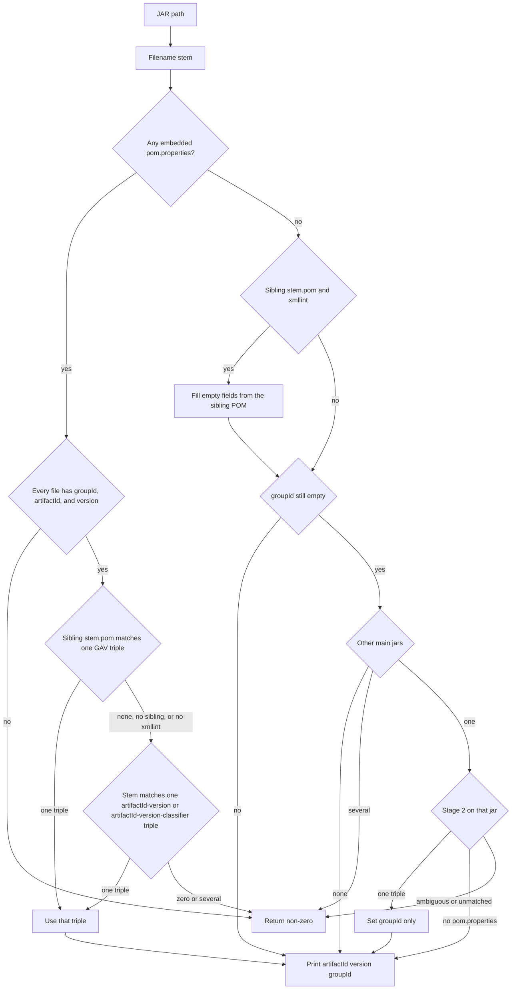

# `get_jar_metadata` resolution matrix

Reference for how `get_jar_metadata` in `package_utils.sh` resolves Maven coordinates.
Output format: `artifactId version groupId` (space-separated). An unknown `groupId` is empty.

```text
① Filename stem
② Embedded pom.properties, when any exist
③ Sibling POM, only when ② found none
④ Main-jar groupId lookup, only when groupId is still empty
```

When embedded properties exist, stage ② selects one triple or fails the JAR. It does not continue to stages ③ or ④. When none exist, those stages run.

---

## Stage ① — Filename stem

Runs first. Stages ② and ③ replace these values when they have a coordinate to apply. The parser splits only `javadoc` and `sources`.

| JAR filename pattern | Example                    | artifactId           | version              | Notes                                                     |
| -------------------- | -------------------------- | -------------------- | -------------------- | --------------------------------------------------------- |
| No version segment   | `test.jar`                 | `test`               | `test`               | Whole stem used for both                                  |
| Standard GAV stem    | `my-app-1.0.0.jar`         | `my-app-1.0.0`       | `my-app-1.0.0`       | Stem is not split into artifact and version               |
| Child module stem    | `child-one-1.0.0.jar`      | `child-one-1.0.0`    | `child-one-1.0.0`    | Same; later stages supply the real GAV                    |
| Javadoc classifier   | `my-app-1.0.0-javadoc.jar` | `my-app`             | `1.0.0`              | Suffix stripped                                           |
| Sources classifier   | `my-app-1.0.0-sources.jar` | `my-app`             | `1.0.0`              | Same as javadoc                                           |
| Other classifier     | `my-app-1.0.0-tests.jar`   | `my-app-1.0.0-tests` | `my-app-1.0.0-tests` | Stage ① leaves the stem whole; stage ② can still match it |

---

## Stage ② — Embedded `pom.properties`

`_select_embedded_pom_props` lists every zip entry whose name ends in `pom.properties` and reads `groupId`, `artifactId`, and `version` from each file.

A file missing any of the three fields fails the JAR.

Selection:

1. When `{stem}.pom` exists and `xmllint` is available, read its GAV with `_maven_read_pom_gav` (parent `groupId` and `version` fallback). Embedded entries whose three fields equal that GAV are one match. One such triple is the result. Zero triples continue to the basename rule.
2. Otherwise the JAR stem must match `artifactId-version` or `artifactId-version-` plus a non-empty classifier. `my-app-1.0.0-javadoc` and `my-app-1.0.0-tests` match artifact `my-app` version `1.0.0`. `foo-1.0` does not match stem `foo-1.0.0`.
3. One distinct triple is the result. Two zip paths with the same triple are one match. Two groupIds that share artifact and version are a failure.
4. Zero basename matches, or more than one triple, fails the JAR. Stdout is empty. Stderr lists each embedded `groupId:artifactId:version` and zip path.

The zip path, archive order, and parent artifactId are not inputs to the match. With `xmllint` absent, rule 1 is skipped and rule 2 still runs.

| Layout                      | Example                                                                                             | Result                                                          |
| --------------------------- | --------------------------------------------------------------------------------------------------- | --------------------------------------------------------------- |
| One matching triple         | `my-app-1.0.0.jar` with `com.example.app:my-app:1.0.0`                                              | That GAV, including when a sibling POM names a different GAV    |
| Shaded JAR                  | `bulk-loader-1.2.3.jar` with `slf4j-api` and `bulk-loader`                                          | `bulk-loader` GAV in either zip order                           |
| Parent and child embedded   | `child-one-1.0.0.jar` with both POMs                                                                | Child GAV                                                       |
| Sibling GAV                 | `test.jar` plus `test.pom` for `com.example:my-app:2.1.0`, jar also embeds `com.other:my-app:2.1.0` | Sibling GAV                                                     |
| Classifier suffix           | `my-app-1.0.0-javadoc.jar`, `my-app-1.0.0-tests.jar`                                                | Module GAV when that triple is the only basename match          |
| SNAPSHOT stem, two versions | `my-app-1.0.0-SNAPSHOT.jar` embeds `1.0.0` and `1.0.0-SNAPSHOT`                                     | Failure. A sibling POM for `1.0.0-SNAPSHOT` selects that triple |
| Two groupIds                | `my-app-1.0.0.jar`, no sibling POM                                                                  | Failure                                                         |
| Stem matches nothing        | `renamed.jar` with one POM                                                                          | Failure                                                         |
| Same GAV, two paths         | `my-app-1.0.0.jar`                                                                                  | That GAV                                                        |
| Incomplete properties       | missing `version`                                                                                   | Failure                                                         |
| No embedded properties      | manifest only                                                                                       | Stage ② returns no triple; stages ③ and ④ run                   |

---

## Stage ③ — Sibling POM (`{stem}.pom`)

Runs only when stage ② found no `pom.properties`.

**Conditions:**

- `{jar_dir}/{stem}.pom` exists
- `xmllint` is available

**Effect:** Each field is updated only when the POM supplies a non-empty value (`_maven_read_pom_gav`, with `<parent>` fallback for `groupId` and `version`).

| Sibling POM shape                  | Example files                     | artifactId           | version                 | groupId                              | Test                                                                   |
| ---------------------------------- | --------------------------------- | -------------------- | ----------------------- | ------------------------------------ | ---------------------------------------------------------------------- |
| Direct GAV on `<project>`          | `test.jar` + `test.pom`           | from POM             | from POM                | from POM                             | `reads name, version and group from a sibling POM`                     |
| Parent only (no child coords)      | `test.jar` + parent-only POM      | filename `test`      | from `<parent>` `1.0.0` | from `<parent>` `com.example.parent` | `keeps filename pkgname when sibling POM inherits all GAV from parent` |
| Child `artifactId` + inherited GAV | `child-one-1.0.0.jar` + child POM | from POM `child-one` | from `<parent>` `1.0.0` | from `<parent>` `com.example.parent` | `resolves child module GAV…`                                           |
| Sibling missing                    | `foo.jar`, no `foo.pom`           | stage ①              | stage ①                 | empty                                | `keeps the filename when the jar has no pom and no sibling`            |
| `xmllint` absent                   | `test.jar` + sibling POM          | stage ①              | stage ①                 | empty                                | `skips a sibling POM when xmllint is absent`                           |

---

## Stage ④ — Main-jar `groupId` lookup

Runs only when `groupId` is still empty (no embedded properties, and stage ③ did not set a group).

Other JARs in the same directory named `{pkgname}-*.jar` are candidates, excluding the current file and names containing `javadoc` or `sources`.

| Candidates | Result                                                                                                                                                                        |
| ---------- | ----------------------------------------------------------------------------------------------------------------------------------------------------------------------------- |
| None       | `groupId` stays empty                                                                                                                                                         |
| One        | That JAR is passed through stage ②. A selected triple sets `groupId` only. No `pom.properties` leaves `groupId` empty. An ambiguous or unmatched set fails the classifier JAR |
| Several    | Failure. Stderr lists the candidate paths                                                                                                                                     |

| Scenario                          | Example                                                                 | artifactId | version | groupId           |
| --------------------------------- | ----------------------------------------------------------------------- | ---------- | ------- | ----------------- |
| Javadoc + one main JAR            | `my-app-1.0.0-javadoc.jar` and `my-app-1.0.0.jar` with one matching POM | `my-app`   | `1.0.0` | from the main JAR |
| Sources + one main JAR            | `my-app-1.0.0-sources.jar` and the same main JAR                        | `my-app`   | `1.0.0` | from the main JAR |
| Classifier alone                  | `my-app-1.0.0-javadoc.jar`                                              | `my-app`   | `1.0.0` | empty             |
| Main JAR has no properties        | javadoc JAR + manifest-only main JAR                                    | `my-app`   | `1.0.0` | empty             |
| Two other `my-app-*.jar` files    | javadoc JAR + `my-app-1.0.0.jar` + `my-app-9.9.9.jar`                   |            |         | failure           |
| Main JAR properties are ambiguous | two groupIds for `my-app-1.0.0` inside the main JAR                     |            |         | failure           |

---

## Callers

`process_jar` and `_upload_jar_entry` return non-zero when `get_jar_metadata` fails. A failed selection does not structure the JAR and does not move it to the generic directory. A successful read with an empty `groupId` still uses the generic directory.

---

## Combined scenarios

| #   | Layout                                       | pom.properties                                   | Sibling POM           | Expected output                                |
| --- | -------------------------------------------- | ------------------------------------------------ | --------------------- | ---------------------------------------------- |
| 1   | Flat `test.jar` + `test.pom` (direct GAV)    | No                                               | Direct GAV            | `my-app 2.1.0 com.example.direct`              |
| 2   | Flat `test.jar` + parent-only POM            | No                                               | Parent only           | `test 1.0.0 com.example.parent`                |
| 3   | Flat `child-one-1.0.0.jar` + child POM       | No                                               | Parent + `artifactId` | `child-one 1.0.0 com.example.parent`           |
| 4   | Nested `child-one-1.0.0.jar`                 | One triple, matches the stem and the sibling GAV | Child POM             | `child-one 1.0.0 com.example.parent`           |
| 5   | `my-app-1.0.0-javadoc.jar` + one main JAR    | Main: one match                                  | Optional              | `my-app 1.0.0` and the main JAR group          |
| 6   | `my-app-1.0.0.jar` only                      | No                                               | No                    | `my-app-1.0.0 my-app-1.0.0` and an empty group |
| 7   | `test.jar` only                              | No                                               | No                    | `test test` and an empty group                 |
| 8   | Flat `test.jar` + sibling POM, no `xmllint`  | No                                               | Present               | `test test` and an empty group                 |
| 9   | Shaded `bulk-loader-1.2.3.jar`               | Module plus a dependency                         | No                    | Module GAV                                     |
| 10  | `my-app-1.0.0.jar`, two groupIds             | Two basename matches                             | No                    | Failure                                        |
| 11  | `test.jar` + sibling GAV, extra embedded GAV | Two triples, stem matches neither                | Matching one triple   | Sibling GAV                                    |

---

## Decision flow



---

## Test coverage

| Variation                                                 | Covered by                    |
| --------------------------------------------------------- | ----------------------------- |
| Direct, parent-only, and inherited sibling POMs           | `test_metadata.bats`          |
| Filename only, javadoc and sources stems                  | `test_metadata.bats`          |
| `xmllint` absent                                          | `test_metadata.bats`          |
| Shaded JAR, parent plus child, decoy paths, duplicate GAV | `test_metadata.bats`          |
| Sibling full GAV, classifier suffix, SNAPSHOT stem        | `test_metadata.bats`          |
| Ambiguous basename, renamed JAR, incomplete properties    | `test_metadata.bats`          |
| Main-jar groupId, several main JARs, ambiguous main JAR   | `test_metadata.bats`          |
| `process_jar` failure does not copy the JAR               | `test_metadata.bats`          |
| POM structuring                                           | `test_maven_structuring.bats` |

---

## Related code

| File                                            | Role                                                                                                                |
| ----------------------------------------------- | ------------------------------------------------------------------------------------------------------------------- |
| `package_utils.sh` `_select_embedded_pom_props` | Chooses one embedded triple or fails                                                                                |
| `package_utils.sh` `get_jar_metadata`           | Runs the four stages                                                                                                |
| `package_utils.sh` `process_jar`                | Structures a JAR and returns on selection failure                                                                   |
| `entrypoint.sh` `_upload_jar_entry`             | Uploads a JAR and returns on selection failure                                                                      |
| `lib/maven-helpers.sh` `_maven_read_pom_gav`    | Sibling POM GAV, with parent fallback                                                                               |
| `tests/helpers/maven_fixtures.bash`             | `make_jar_with_embedded_poms`, `make_jar_with_pom_props_at`, `make_flat_jar_with_pom`, `make_maven_jar_with_coords` |
